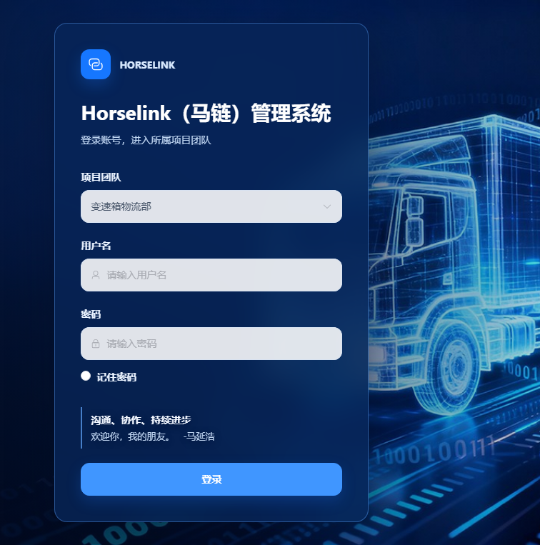
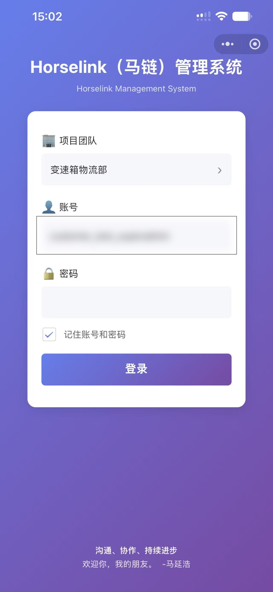
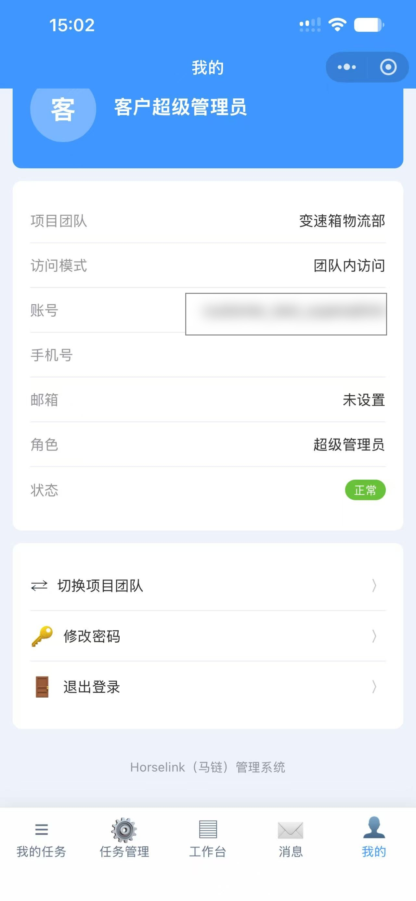

# 马链 / Horselink 企业协同与设备运营平台

马链（Horselink）是面向物流与生产团队的企业协同管理系统，提供 PC Web、Node.js 后端和微信小程序三端能力。项目已完成线上部署，正式访问地址为 [www.horselink.cn](https://www.horselink.cn/)。本仓库保留可审阅的应用源码、测试、部署脚本和项目文档，不包含客户数据库、上传附件、生产凭证或运行时日志。

## 项目概览

- **多团队任务协同**：在同一系统内隔离不同项目团队，覆盖任务创建、指派、执行、审核、延期、附件、消息和统计。
- **设备全生命周期**：设备台账、照片、Excel 导入导出、一物一码、二维码查询、盘点、点检、维修、保养和闲置/停用/报废状态审批。
- **运输与生产数据提报**：运输记录、司机/车辆信息、生产排产、按日提报、缺报提醒、锁定、审核、月度汇总和导出。
- **组织与经营管理**：用户/岗位权限、组织层级、供应商合同、结算费用、消息通知、附件管理和审计日志。
- **微信小程序现场作业**：登录与团队切换、任务处理、扫码查设备、现场点检/保养/维修、数据提报、消息查看和个人中心。

## 技术栈

- PC Web：Vue 3、Pinia、Element Plus、Vite
- 服务端：Node.js 22、Express、MongoDB、Mongoose、JWT、Multer、ExcelJS
- 微信小程序：uni-app、Vue 3、Pinia，复用同一套 API、团队隔离和权限规则
- 工程与质量：Node.js Test Runner、Supertest、MongoDB Memory Server、部署/回滚脚本、健康检查

## 关键实现

1. 以活动团队作为所有任务、设备、提报、人员、消息、附件、照片、查询、统计、导出和审计记录的隔离边界；后端接口和小程序请求均执行服务端权限校验。
2. 将设备点检、维修、保养和状态审批实现为固定状态机，并保留申请、审批、异常照片、处理过程和设备时间线。
3. 将日提报的时间锁定、缺报禁止汇总、考勤员补报/修改、审核快照和经理通知固化为可追溯流程。
4. 为附件、导入、迁移、备份恢复和发布回滚提供独立工具与运行手册，开发/测试数据与生产数据分离。

## 仓库结构

- `app/`：Node.js API 与 Vue 3 PC Web 源码
- `miniprogram/`：uni-app / Vue 3 微信小程序源码
- `docs/`：需求、架构、部署、运维和交付记录
- `tools/`：快照、迁移、检查和部署工具
- `tests/`：后端、前端、小程序和团队隔离测试

## 线上状态与边界

- 线上入口：[https://www.horselink.cn/](https://www.horselink.cn/)
- 健康检查：[https://www.horselink.cn/health](https://www.horselink.cn/health)
- 当前公开截图仅展示登录页和脱敏后的小程序界面，不提供可用账号或密码。
- 源码仓库为私有仓库；客户数据、生产环境变量、账号密码、JWT、Cookie、上传文件和日志均不纳入 Git。
- 小程序截图位于 `docs/screenshots/mini-program/`，已对原图中的测试账号字段做脱敏处理；网站截图位于 `docs/screenshots/web/`。

## 界面截图

网站正式入口（登录页）：

微信小程序登录与现场协同界面（截图中的测试账号已脱敏）：

| 登录 | 我的任务 | 工作台 |
| --- | --- | --- |
|  |  |  |

| 个人中心 | 任务管理 |
| --- | --- |
|  |  |

## 交付文档

- `docs/管理系统本次开发需求范围确认书-v0.4.md`：业务范围与交付边界
- `docs/管理系统V1.0开发设计文档-v0.2.md`：架构、权限、模块和小程序页面设计
- `docs/OPERATIONS_RUNBOOK.md`：备份、恢复、保留策略和健康监控
- `docs/RELEASE_DEPLOYMENT_AND_ROLLBACK.md`：发布、回滚和小程序版本管理
- `docs/CUSTOMER_OPERATION_GUIDE.md`：客户操作说明
