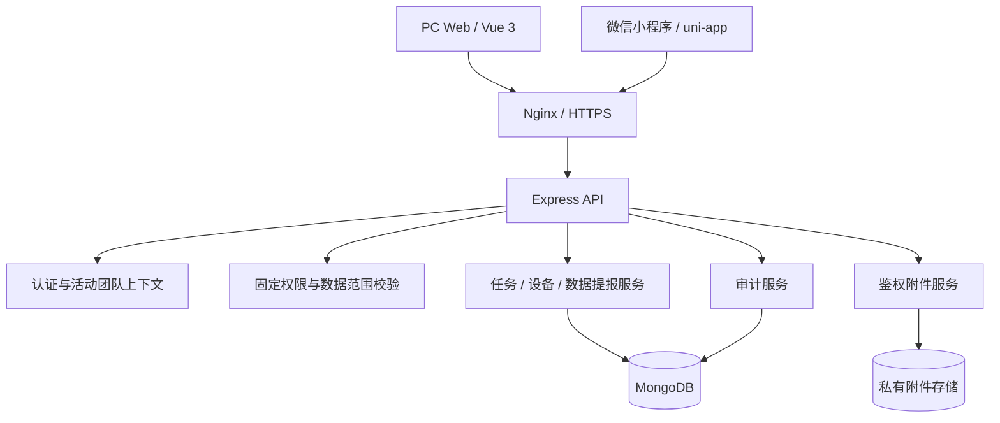
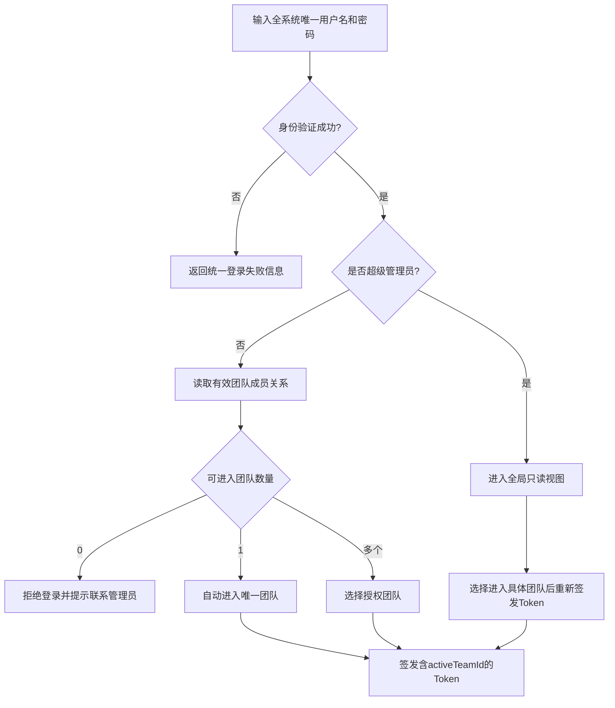

# 管理系统 V1.0 开发设计文档

| 项目 | 内容 |
|---|---|
| 文档属性 | 内部开发、估算及交付依据 |
| 文档版本 | v0.2（客户回复整理版） |
| 编制日期 | 2026年7月16日 |
| 关联客户文件 | 《管理系统本次开发需求范围确认书》v0.4 |
| 当前状态 | 主要范围已确认，7项实施细节待补充后冻结 |

> 本文中的“V1.0”仅是内部版本编号，等同于“本次开发”，不是客户承诺的后续分期。v0.2已吸收客户2026年7月16日回复；文中标记为D-01至D-07的实施细节在客户回复前不作扩大解释。

## 1. 文档目标与依据

### 1.1 建设目标

在不丢失现有生产数据、不破坏现有任务管理流程的前提下，完成以下升级：

1. 保留并改造现有任务管理模块。
2. 新增设备管理模块：台账、二维码、盘点、点检、维修、保养及闲置/停用/报废审批；不做领用调拨和配件库存。
3. 新增数据提报模块。
4. 增加项目团队隔离、两级管理员、固定权限勾选及审计能力。
5. 导入现有固定资产台账和设备照片，异常由客户确认后处理。
6. 保持PC网站和微信小程序共用同一后端及同一套权限规则。

### 1.2 需求信息来源

- 历史需求会话 `019f59ab-5471-7822-a3bb-b231686aaf69`。
- 本轮客户补充聊天记录及用户逐项确认结果。
- 《提报类（开发）(1).xlsx》原型及客户更新后的《提报类（开发）(3).xlsx》最终沟通稿。
- 客户《注释(1).xlsx》逐项答复及2026年7月16日聊天截图。
- 《变速箱物流部2026年中固定资产盘点表.xlsx》及内嵌图片。
- PC Web、Node.js后端和uni-app小程序源码只读检查结果。
- 2026年7月15日生产环境、数据量和部署状态检查结果。

### 1.3 已确认的范围基线

| 编号 | 已确认内容 |
|---|---|
| C-01 | 新增的是“设备管理”和“数据提报”两个完整业务模块，不是两个报表页面 |
| C-02 | 系统最终包含任务管理、设备管理、数据提报三个业务模块 |
| C-03 | 项目团队之间的业务数据、附件、统计和导出完全隔离 |
| C-04 | 超级管理员可跨团队查看，但全局状态默认只读 |
| C-05 | 超级管理员必须进入具体团队后才能修改，并记录切换及修改审计日志 |
| C-06 | 项目管理员只能管理本团队普通成员的状态、组织和固定权限，不能跨团队或自行提升管理员 |
| C-07 | V1.0采用固定权限项勾选，不开发通用权限平台 |
| C-08 | 用户名在全系统唯一 |
| C-09 | 现有台账和照片全部纳入迁移处理范围，可识别数据直接导入，异常经客户确认后处理 |
| C-10 | 现有用户、任务、审核、延期、消息、附件/文件及关联记录暂统一归入“变速箱物流部” |
| C-11 | 上线前由客户指定首个超级管理员并首次改密，其余团队管理员由客户上线后自行配置 |
| C-12 | 数据提报使用固定表单，后续新增模板另行计费 |
| C-13 | 设备配件及配件库存不开发 |
| C-14 | 数据提报按《提报类（开发）(3).xlsx》实现，新增出勤月度汇总 |
| C-15 | “昨日实际完成量”按昨日生产日报的“今日排产”取值，即排产计划视为实际完成量 |
| C-16 | 7个分部各设指定提报账号；09:00后分部账号锁定，部门考勤员可处理7个分部补报/修改 |
| C-17 | 7个分部未全部提交时禁止生成汇总，并提醒缺报提报人和部门考勤员 |
| C-18 | 数据提交后由部门考勤员审核，审核后推送部门经理 |
| C-19 | 设备A/B/C/E/F/G/H功能全部开发，仅D“领用调拨”不做 |
| C-20 | 盘点采用盘点人、分部经理、部门副经理、部门经理四级固定审批 |
| C-21 | 组织分5级；普通员工/班组长/分部管理层看本分部，部门资产管理员及部门管理层看7个分部 |

### 1.4 仍待补充的实施细节

| 编号 | 待确认内容 | 对设计的影响 |
|---|---|---|
| D-01 | 部门经理收到推送后仅查看，还是需要最终审批 | 提报状态机、消息 |
| D-02 | 部门考勤员09:00后可修改到何时；审核后修改是否需退回/重开 | 锁定、审计、版本 |
| D-03 | 固定点检项目、周期、异常处理、照片和提醒规则 | 点检模板、计划任务 |
| D-04 | 维修与保养固定步骤、周期、到期和逾期提醒规则 | 工单状态、通知 |
| D-05 | 闲置、停用、报废的固定审批岗位 | 状态审批模型 |
| D-06 | 盘点中经理助理能否代替副经理；PC端和小程序最终页面分工 | 审批人匹配、页面工期 |
| D-07 | 出勤月报的“请假”是否包含日报中的“病假”，或需单列病假 | 月报字段和汇总口径 |

开发前应将D-01至D-07补成固定规则。V1.0不建设动态工作流平台，所有审批链按最终确认结果写成固定配置和固定状态机。

## 2. 当前系统基线

### 2.1 当前业务和数据

现有系统本质为已投入使用的任务分配管理系统，当前已有用户、任务、审核、延期、消息和附件等真实生产数据。2026年7月15日最近一次统计基线：

| 数据对象 | 数量 |
|---|---:|
| 用户 | 20 |
| 任务 | 25 |
| 审核 | 25 |
| 延期 | 20 |
| 消息 | 568 |
| 附件 | 292 |

正式迁移前必须重新统计并生成集合数量、记录数量和附件文件数量清单；本表只用于估算，不作为最终迁移验收值。

### 2.2 现有技术栈

**后端**

- Node.js运行时。
- Express 4 Web框架。
- MongoDB数据库、Mongoose 8 ODM。
- JWT登录认证。
- Multer文件上传。
- SheetJS Excel导入导出。
- Nginx HTTPS、静态资源和反向代理。

**PC Web**

- Vue 3.4。
- Vite 5。
- Pinia 2.1.7。
- Vue Router 4.2.5。
- Axios 1.6.2。
- Element Plus 2.5。
- ECharts 5.4.3、vue-echarts 6.6.8。
- Day.js 1.11.10、Sass 1.69.5。

**微信小程序**

- uni-app + Vue 3。
- Pinia 2.1.7。
- HBuilderX编译为微信小程序产物。
- 微信开发者工具预览、真机调试、上传和发布。

小程序源码可继续复用，但当前工程未固定HBuilderX版本、没有可执行的npm构建脚本和锁文件。开发启动时必须封存一套可复现的构建环境及发布说明，不能直接维护`unpackage`编译产物。

### 2.3 当前部署拓扑

以最新运行状态为准：

- 公网域名和入口继续使用旧云服务器。
- 旧云服务器负责Nginx转发，不作为业务备份目的地。
- 新实体机运行Windows及Linux虚拟机。
- Linux虚拟机运行Nginx、Node.js应用、MongoDB和业务附件。
- 新机通过稳定通道接收旧云服务器的公网请求。
- 生产发布目录采用release形式，当前版本路径在部署时重新核验。
- 数据备份保存到新机非系统盘或专用备份盘，不保存到旧服务器。

虚拟机当前规划约50 GB内存、宿主机逻辑处理器约80%的vCPU、约200 GB虚拟磁盘，相关文件位于宿主机E盘。备份目标盘的真实物理磁盘对应关系必须在实施前核验，不能只按Windows盘符判断。

### 2.4 已知结构限制和技术债

- 当前系统为单团队模型，用户只有全局角色及文本型`department`。
- JWT没有完整的活动团队上下文。
- Task、Review、Extension、Message及附件链路没有统一`teamId`。
- 附件曾采用可直接访问的静态路径，不能满足团队完全隔离要求。
- 小程序登录页存在明文缓存密码的历史实现，必须删除。
- 小程序延期日期使用非标准字符串直接构造Date，iPhone兼容性需修复。
- 自定义TabBar未读角标、附件URL双斜杠等问题应纳入回归修复清单。
- 后端本地交接包缺少完整的根目录依赖清单、锁文件和环境变量示例；开工前应从生产运行版本建立可复现基线。
- 历史检查曾发现公开注册和角色传入风险；是否已经全部修复必须按当前运行接口重新验证，不能按旧源码直接判断。

## 3. 目标架构

### 3.1 逻辑架构



### 3.2 架构原则

1. 保留Vue、uni-app、Express、MongoDB技术路线，不为当前规模引入微服务。
2. 项目团队隔离由后端和数据库查询强制执行，前端隐藏菜单只能作为交互优化。
3. 客户端提交的任意`teamId`都不能成为授权依据。
4. 服务端根据已验证Token中的活动团队决定查询和写入范围。
5. 多团队底座先于三个业务模块改造完成。
6. 所有列表、详情、搜索、关联选择、统计、导出、消息和附件使用同一隔离规则。
7. 生产数据迁移通过脚本执行，脚本必须可重放、有对账结果、有回滚点。

### 3.3 推荐代码分层

在不大规模重构现有工程的前提下，建议逐步形成：

```text
routes        HTTP路由及参数入口
controllers   请求响应编排
services      业务规则、团队隔离、事务边界
models        Mongoose模型和索引
middlewares   认证、活动团队、权限、只读模式、错误处理
repositories  可选；复杂查询和聚合集中管理
utils         文件、Excel、日期、审计等通用工具
```

现有简单接口可逐步迁移到service层，不做与交付无关的全面重写。

## 4. 项目团队、身份和权限设计

### 4.1 核心概念

- **ProjectTeam**：最高业务隔离单位，例如“变速箱物流部”。
- **OrgUnit**：团队内部组织树；“变速箱物流部”为团队，下面建立7个分部，后续可挂班组。
- **TeamMembership**：用户与团队的成员关系，保存系统管理角色、组织归属、岗位层级、功能岗位和固定权限。
- **PositionLevel**：一级部门经理、二级副经理/经理助理、三级分部经理/副经理、四级班组长、五级普通员工。
- **FunctionalRole**：部门考勤员、分部指定提报人、部门资产管理员等与岗位层级分离的业务职责。
- **DataScope**：`ORG_UNIT`仅本分部，或`TEAM`查看整个项目团队7个分部。
- **ActiveTeam**：当前会话实际进入的项目团队。
- **GlobalReadOnly**：超级管理员跨团队查看使用的全局只读上下文。

原有文本`department`不得继续承担项目团队隔离职责；迁移后使用`teamId + orgUnitId`。

### 4.2 登录和团队切换



- 用户名使用标准化字段做全局唯一索引，建议去除首尾空格并统一大小写规则。
- 团队切换必须调用后端接口，重新签发短期Token。
- Token至少包含`userId`、`mode`、`activeTeamId`、`tokenVersion`，不在Token中保存完整权限快照或敏感信息。
- 全局只读Token的`activeTeamId`为空，任何写请求由中间件统一拒绝。
- 超级管理员进入团队、退出团队和切换团队均写审计日志。
- 每个请求校验账号状态和有效TeamMembership；权限或成员关系被撤销后，旧Token不能继续依靠过期权限访问。
- 使用`AuthSession/jti`记录当前会话模式和活动团队。切换团队后撤销该会话的旧Token，注销仅撤销当前会话；改密、停用账号或全局安全事件可递增`tokenVersion`撤销该用户全部Token。

### 4.3 角色职责

客户所称“普通管理员”在本文中统一命名为“项目管理员”，与“普通成员”区分。项目管理员由超级管理员进入目标团队后设置或撤销，项目管理员自身不能把普通成员提升为项目管理员。

**超级管理员**

- 创建、启用、停用项目团队。
- 在全局只读视图查看各团队数据和统计。
- 主动进入某个团队后执行管理或业务修改。
- 查看跨团队审计记录。
- 不得在全局只读状态直接新增、修改或删除团队业务数据。

**项目管理员**

- 只能进入其所属项目团队。
- 管理本团队组织，以及普通成员的状态和固定权限。
- 不得提升或撤销项目管理员；该操作只能由超级管理员进入目标团队后完成。
- “项目管理员”是系统管理身份，不自动等于业务部门经理；业务数据范围仍由岗位层级、功能岗位和`DataScope`决定。
- 不得创建超级管理员、提升全局身份或访问其他团队业务数据。

**普通成员**

- 只能进入有效成员关系对应的团队。
- 按固定权限项访问页面和接口。
- 普通员工、班组长、分部经理/副经理使用`ORG_UNIT`范围，只查看所属分部数据。
- 部门资产管理员、部门经理助理、部门副经理、部门经理在业务模块使用`TEAM`范围，可查看7个分部数据。
- 部门考勤员对出勤提报具有`TEAM`范围的补报、修改和审核权限，不因此自动获得其他模块全量修改权限。

### 4.4 固定权限项

V1.0权限键由代码统一维护，项目管理员只能勾选，不允许在后台新增权限类型。

| 模块 | 建议权限键 |
|---|---|
| 任务 | `task.view`、`task.create`、`task.edit`、`task.assign`、`task.review`、`task.export` |
| 设备 | `equipment.view`、`equipment.create`、`equipment.edit`、`equipment.import`、`equipment.export`、`equipment.qrcode`、`equipment.inventory`、`equipment.inspect`、`equipment.repair`、`equipment.maintain`、`equipment.status.apply`、`equipment.status.approve` |
| 数据提报 | `report.view`、`report.submit`、`report.review`、`report.correct`、`report.export`、`report.schedule.manage`、`report.monthly.generate` |
| 团队管理 | `member.view`、`member.manage`、`org.manage`、`reporter.assign` |
| 审计 | `audit.view` |

本次不提供`equipment.transfer`。前端菜单权限、按钮权限和后端接口权限使用相同权限键；功能岗位只能从固定列表分配。

### 4.5 数据隔离强制规则

- 每个团队业务集合必须保存`teamId`且建立索引。
- 详情查询必须使用`{ _id, teamId }`，禁止先按`_id`读取再在控制器中判断。
- 无权访问其他团队资源统一返回404，减少资源ID探测。
- 聚合统计的第一阶段必须加入团队过滤。
- 导出必须重新执行团队过滤，不能直接复用客户端列表。
- 创建任务、指派用户、引用设备、下载附件时校验全部关联对象属于活动团队。
- 团队过滤后再叠加组织数据范围：`ORG_UNIT`强制加入`orgUnitId`过滤，`TEAM`只保留`teamId`过滤。
- 部门考勤员的`TEAM`范围只作用于出勤提报资源；不能把某模块的全量范围复用到其他模块。
- 请求体或查询字符串中的`teamId`仅可作为超级管理员全局只读筛选条件，普通业务写入时忽略或拒绝。
- 小程序缓存键包含用户和团队维度；切换团队时清理旧团队业务缓存。

## 5. 数据模型设计

所有模型保留`createdAt`、`updatedAt`；需要软删除的集合增加`deletedAt`、`deletedBy`。正式字段以代码现状和客户确认结果为准。

### 5.1 组织与账号

**ProjectTeam**

| 字段 | 说明 |
|---|---|
| `_id` | 主键 |
| `code` | 团队编码，全局唯一 |
| `name` | 团队名称 |
| `status` | ACTIVE / DISABLED |
| `settings` | 少量固定配置，不作为低代码入口 |
| `createdBy` | 创建人 |

**User**

| 字段 | 说明 |
|---|---|
| `username` | 登录名 |
| `usernameNormalized` | 标准化登录名，全局唯一索引 |
| `passwordHash` | 密码哈希 |
| `displayName`、`phone` | 基本资料 |
| `isSuperAdmin` | 是否超级管理员 |
| `status` | 账号状态 |
| `tokenVersion` | 强制Token失效版本号 |

**OrgUnit**

- `teamId`、`parentId`、`type`（DEPARTMENT / SUB_DEPARTMENT / TEAM_GROUP）。
- `code`、`name`、`status`、`sortOrder`、`path`。
- 唯一索引：`teamId + code`；`path`用于服务端快速计算组织范围。

**TeamMembership**

- `teamId`、`userId`、`orgUnitId`。
- `role`：`PROJECT_ADMIN`或`MEMBER`。
- `positionLevel`：1至5级固定层级。
- `functionalRoleKeys`：`ATTENDANCE_REPORTER`、`ATTENDANCE_OFFICER`、`ASSET_ADMIN`等。
- `permissionKeys`、`moduleDataScopes`、`status`、`joinedAt`。
- 唯一索引：`teamId + userId`。

`moduleDataScopes`由固定岗位规则生成：普通员工、班组长和分部管理层为`ORG_UNIT`；部门资产管理员及一级/二级部门管理层在业务模块为`TEAM`；部门考勤员仅在出勤模块为`TEAM`。禁止前端直接提交任意范围值。

**AttendanceReporterAssignment**

- `teamId`、`orgUnitId`、`userId`、`status`、`effectiveFrom`、`effectiveTo`。
- 每个分部同一时间只能有一个有效指定提报人；更换提报人记录审计，不改写历史提交人。

数据模型允许同一账号加入多个团队；客户若确认普通用户只能属于一个团队，在业务层增加限制，不修改核心结构。

**AuthSession**

- `jtiHash`、`userId`、`mode`、`activeTeamId`。
- `tokenVersion`、`issuedAt`、`expiresAt`、`revokedAt`、`revokeReason`。
- `jtiHash`建立唯一索引，`expiresAt`建立TTL索引清理过期会话。
- Token仅携带随机`jti`，数据库保存其哈希；每次请求同时检查会话未撤销、账号有效和成员关系有效。
- 团队切换时使用数据库事务，或使用带“旧会话仍有效”条件的原子更新撤销旧`jti`并签发新会话；并发切换只能有一个请求成功。注销按当前`jti`原子写入`revokedAt`。

### 5.2 现有任务模块

下列现有集合及其关联对象全部增加`teamId`：

- Task。
- Review。
- Extension。
- Message。
- FileAsset或现有附件记录。
- 任务通知、操作记录及统计数据源。

负责人、执行人、抄送人和审核人必须具有当前团队的有效成员关系。原有`admin/executor/cc`角色需要迁移为全局身份、团队成员角色和固定权限的组合，不能机械照搬为全局角色。

### 5.3 设备模块

**EquipmentAsset**

- `teamId`、`assetCode`、`name`、`categoryId`。
- `specification`、`manufacturer`、`quantity`、`unit`。
- `acquisitionDate`、`originalValue`。
- `orgUnitId`、`custodianUserId`、`location`。
- `status`、`sourceImportJobId`、`qrCode`、`remark`。
- 建议唯一索引：`teamId + assetCode`；原始重复编号先进入异常清单。

**EquipmentCategory**

- `teamId`、`name`、`parentId`、`sortOrder`、`status`。

**EquipmentChangeRecord**

- `teamId`、`equipmentId`、`changeType`。
- `before`、`after`、`operatorId`、`reason`、`occurredAt`。

**InventorySession / InventoryItem / InventoryApproval**

- 记录盘点批次、组织范围、盘点项、账实差异和四级审批状态。
- 固定审批顺序：盘点人提交、分部经理、部门副经理、部门经理。
- 每一步保存审批人、岗位快照、意见、时间和退回原因；不得由客户端跳级。

**InspectionTemplate / InspectionPlan / InspectionRecord**

- 固定点检项目、周期、计划日期、执行结果、异常、照片和处理状态。
- 具体周期和提醒规则由D-03补齐。

**RepairOrder**

- 故障描述、报修人、设备、照片、处理人、处理过程、结果、完成时间和状态。
- 固定状态机在D-04确认后冻结。

**MaintenancePlan / MaintenanceRecord**

- 保养周期、下次日期、提醒时间、执行记录、材料备注和结果；不关联配件库存。
- 到期及逾期提醒规则由D-04补齐。

**EquipmentStatusApplication / EquipmentStatusApproval**

- 支持闲置、停用、报废申请及固定审批，保存申请原因、附件、审批快照和最终状态。
- 审批岗位由D-05补齐。

不建立领用调拨、设备配件、仓库、库存流水、采购和配件成本模型。

### 5.4 数据提报模块

建议不同业务类型使用独立结构化集合，不把所有表单塞进一个任意JSON模型：

- `TransportRecord`：运输/运营记录和现场照片。
- `AttendanceSubmission`：按日期、分部、班次及人员状态记录出勤、版本和锁定状态。
- `AttendanceReview`：部门考勤员审核、退回、修改、审核快照和部门经理推送状态。
- `AttendanceMonthlySummary`：按月份从已确认日数据生成；可按需计算并保存生成快照。
- `ProductionSchedule`：上月、当月和月度排产。
- `GeneratedDailyReport`：生成的日报文字、来源快照和版本；“实际完成量”直接引用昨日排产计划。
- `ReportCorrectionRecord`：解锁、补报和纠错记录。

共同字段至少包含`teamId`、`reportDate`、`orgUnitId`、`submitterId`、`status`、`submittedAt`。状态机按C-16至C-18实现，并在D-01/D-02补齐后冻结。

### 5.5 文件和图片

**FileAsset**

- `teamId`、`ownerType`、`ownerId`。
- `storageKey`、`originalName`、`mimeType`、`size`、`sha256`。
- `uploaderId`、`status`、`createdAt`。

文件不通过固定静态URL公开；所有预览和下载先校验活动团队、资源归属和权限。

### 5.6 导入和异常

**ImportJob**

- `teamId`、`type`、`sourceFileId`、`status`。
- `totalRows`、`validRows`、`warningRows`、`errorRows`。
- `createdBy`、`confirmedBy`、`confirmedAt`。

**ImportException**

- `teamId`、`importJobId`、`sheetName`、`rowNumber`。
- `assetCode`、`field`、`exceptionType`、`originalValue`。
- `suggestedValue`、`customerDecision`、`resolvedValue`、`status`。

### 5.7 审计日志

**AuditLog**

- `actorUserId`、`actorRole`。
- `activeTeamId`、`targetTeamId`。
- `action`、`resourceType`、`resourceId`。
- `before`、`after`、`reason`。
- `requestId`、`ip`、`userAgent`、`createdAt`。

审计日志只追加，不允许业务用户修改或删除。密码、Token、文件正文及其他秘密不得写入审计快照；大对象只记录关键字段差异。

## 6. API设计

接口统一使用`/api`前缀，统一返回结构、错误码、请求ID和服务端时间。下列是目标接口清单，正式开发时以OpenAPI或接口测试集合固化。

### 6.1 认证和团队

| 方法 | 路径 | 用途 |
|---|---|---|
| POST | `/api/auth/login` | 验证用户名和密码 |
| GET | `/api/auth/teams` | 获取当前用户可进入团队 |
| POST | `/api/auth/switch-team` | 进入或切换团队并重签Token |
| POST | `/api/auth/global-readonly` | 超级管理员返回全局只读上下文 |
| GET | `/api/auth/me` | 当前用户、模式、团队和权限 |
| POST | `/api/auth/logout` | 注销并使当前会话失效 |

### 6.2 团队、组织和成员

- `GET/POST/PATCH /api/teams`：超级管理员管理团队。
- `GET/POST/PATCH /api/org-units`：项目管理员管理本团队固定层级组织。
- `GET /api/team-members`：按当前身份和团队读取成员。
- `POST/PATCH /api/team-members`：项目管理员仅管理普通成员，服务端字段白名单禁止写入`isSuperAdmin`或`role=PROJECT_ADMIN`。
- `PATCH /api/team-members/:id/admin-role`：仅超级管理员进入目标团队后可设置或撤销项目管理员。
- `PATCH /api/team-members/:id/permissions`：固定权限勾选。
- `GET/POST/PATCH /api/attendance-reporter-assignments`：维护7个分部指定提报人并审计变更。

### 6.3 任务模块

尽量保持现有接口契约，统一在认证中间件、service层和数据库查询层加入团队上下文。任务、审核、延期、消息、附件、统计和导出接口必须全部纳入改造，不能只改任务列表。

### 6.4 设备模块

- `GET /api/equipment`。
- `GET /api/equipment/:id`。
- `POST /api/equipment`、`PATCH /api/equipment/:id`。
- `GET /api/equipment/export`、`GET /api/equipment/:id/history`。
- `POST /api/equipment/:id/qrcode`。
- `POST /api/equipment/imports`。
- `GET /api/equipment/imports/:id`。
- `GET /api/equipment/imports/:id/exceptions`。
- `POST /api/equipment/imports/:id/confirm`。
- `GET/POST /api/equipment/inventories`、`POST /api/equipment/inventories/:id/submit`。
- `POST /api/equipment/inventories/:id/approve`、`POST /api/equipment/inventories/:id/reject`。
- `GET/POST/PATCH /api/equipment/inspection-plans`、`POST /api/equipment/inspection-records`。
- `GET/POST/PATCH /api/equipment/repairs`。
- `GET/POST/PATCH /api/equipment/maintenance-plans`、`POST /api/equipment/maintenance-records`。
- `POST /api/equipment/:id/status-applications`、`POST /api/equipment/status-applications/:id/approve`。

本次不提供设备领用调拨接口。

### 6.5 数据提报模块

- `GET/POST /api/reports/:type`。
- `GET/PATCH /api/reports/:type/:id`。
- `POST /api/reports/:type/:id/submit`。
- `POST /api/reports/:type/:id/unlock`。
- `POST /api/reports/:type/:id/correct`。
- `GET /api/reports/:type/export`。
- `POST /api/daily-reports/generate`。
- `GET /api/attendance/completion-status`：查询7个分部提交状态及缺报单位。
- `POST /api/attendance/:id/review`、`POST /api/attendance/:id/reject`。
- `POST /api/attendance/:id/correct`：仅部门考勤员按D-02规则补报或修改。
- `GET /api/attendance/monthly-summary`、`GET /api/attendance/monthly-summary/export`。

`:type`必须使用服务端白名单，不能根据客户端值动态选择任意MongoDB集合。

### 6.6 文件和审计

- `POST /api/files`：鉴权上传并绑定团队。
- `GET /api/files/:id`：文件元数据。
- `GET /api/files/:id/download`：鉴权下载或短时签名跳转。
- `DELETE /api/files/:id`：按权限软删除。
- `GET /api/audit-logs`：按时间、人员、团队、资源和动作查询。

## 7. PC Web功能和页面

### 7.1 公共页面

- 登录、授权团队选择、当前团队切换。
- 个人信息、登录失效、无权限和404页面。
- 页面固定位置显示当前团队，避免跨团队操作时认错上下文。

### 7.2 超级管理员

- 全局只读概览。
- 项目团队列表、创建、启用和停用。
- 进入指定团队及返回全局视图。
- 跨团队审计查询。
- 全局视图不显示可写按钮，后端仍需拒绝写请求。

### 7.3 团队管理

- 本团队成员、部门、成员状态。
- 固定权限勾选。
- 本团队审计日志。

### 7.4 任务管理

沿用现有界面和主流程，增加当前团队上下文；任务列表、详情、创建、分配、审核、延期、消息、附件、统计和导出都只处理当前团队。

### 7.5 设备管理

- 设备台账列表和详情。
- 现有设备照片展示。
- Excel导入、导入结果、异常清单和一轮客户处理结果。
- 手工新建/编辑、导出、变更记录和二维码打印。
- 盘点批次、差异、四级审批和审批记录。
- 点检计划/记录、维修工单、保养计划/记录。
- 闲置、停用、报废申请及审批。

不建设领用调拨页面。

### 7.6 数据提报

- 运输/运营记录、小程序拍照、查询、司机月度汇总和导出。
- 7个分部指定提报人、出勤提报、缺报状态和09:00锁定。
- 部门考勤员补报/修改、审核、退回和部门经理推送。
- 上月/当月日排产、月排产的PC端维护。
- 生产日报文字生成、复制和来源追溯。
- 出勤月报按月查询、自动汇总和固定模板导出。

## 8. 微信小程序功能和页面

原则上小程序承载现场高频操作，批量维护、导入、复杂查询及权限配置放在PC端：

- 登录、授权团队选择、当前团队标识和切换。
- 原有任务列表、详情、执行、审核和消息。
- 运输现场拍照和提交。
- 出勤提报及部门考勤员现场审核。
- 设备查询、扫码查看、现场点检、维修拍照、盘点和审批等功能按D-06最终双端页面清单确认。

PC端与小程序的最终功能分工需要在页面清单冻结时由客户确认。所有小程序请求必须经过相同的后端团队隔离和权限校验。

## 9. 核心业务流程

### 9.1 任务管理

1. 用户登录并进入活动团队。
2. 在本团队创建、查看或分配任务。
3. 负责人、执行人、抄送人和审核人必须为本团队有效成员。
4. 执行、消息、附件、审核和延期沿用现网实际规则。
5. 统计和导出只计算当前团队。
6. 关键状态变化写入审计日志。

V1.0不重新设计原有任务业务，优先保证行为不回归。

### 9.2 设备数据导入


客户未确认的异常不得由程序猜测后覆盖正式数据。

### 9.3 设备生命周期

设备台账建立后生成唯一二维码，扫码访问鉴权后的设备详情。台账编辑、照片、点检、维修、保养和状态变化全部写入设备时间线。

盘点固定流程：

1. 创建盘点批次并确定组织和设备范围。
2. 盘点人逐项提交账实结果、差异、说明和照片。
3. 分部经理审核；退回时回到盘点人修改。
4. 部门副经理审核。
5. 部门经理终审，批次完成后锁定审批快照。

点检、维修和保养均采用固定状态机，具体步骤按D-03/D-04补齐。闲置、停用、报废由申请单驱动，审批完成后才修改设备正式状态，审批岗位按D-05补齐。本次不实现设备领用调拨。

### 9.4 数据提报

出勤提报固定流程：

1. 每个分部维护一个有效指定提报人；提报人只能选择并提交所属分部。
2. 09:00前可重复提交，新版本覆盖当前展示值，但历史版本保留。
3. 09:00按服务端时间锁定分部提报人。部门考勤员按D-02规则可补报或修改7个分部，必须填写原因并记录前后值。
4. 7个分部未全部提交时禁止生成部门汇总；系统列出缺报分部，并通知对应提报人和部门考勤员。
5. 全部提交后进入部门考勤员审核。审核通过后按D-01规则推送部门经理；退回时通知对应分部提报人。
6. 生产日报文字使用已确认的出勤数据和排产数据生成，并保存来源快照。
7. “昨日实际完成量”直接取昨日生产日报第3项“今日排产”，不设置独立实际完成量字段。
8. 出勤月报按选择月份从每日已确认数据汇总，按固定A:R列模板查询及导出。

业务日期和09:00等截止时间统一按`Asia/Shanghai`解释，由服务端时间判定，不信任手机或浏览器本地时钟；数据库时间戳建议以UTC保存，另存明确的`reportDate`避免跨日歧义。

## 10. Excel原型分析和实现注意事项

### 10.1 数据提报原型

客户更新后的《提报类（开发）(3).xlsx》共9个Sheet；旧版8个Sheet的值和公式均未变化，新增`2.出勤月报-部门汇总`。当前确认规则：

- 运输记录使用字典选项。
- 当前包含13类常用装载器具并预留5类。
- 每车需要2至10张相机照片。
- 支持多条件查询、月度司机趟数汇总和导出。
- 出勤涉及7个分部、白班和夜班。
- 出勤状态包含请假、休班、病假、旷工、未入职、待离职等。
- 09:00前分部提报人可覆盖，09:00后锁定；部门考勤员具备7个分部的补报/修改和审核权限。
- 上月、当月和月度计划由PC端维护。
- 需要生成可复制的生产日报文字。
- “昨日实际完成”按客户确认直接引用昨日排产计划，属于明确业务口径。
- 汇总公式存在漏算31日的问题，开发时按自然月日期计算，不复制错误公式。

新增月报为A:R共18列、31个日期行的展示模板，当前没有Excel公式或数据验证。字段为日期、部门、编制人数、在册人数、白班/夜班的实际出勤、休班、请假、未入职、待离职、旷工，以及帮产人员和备注。系统必须从每日出勤数据计算，按月份实际天数生成，不能复制模板中固定31行。

月报A4:A34在源文件中存储为Excel日期序号且使用General格式；开发时应输出真实日期格式。日报含“病假”字段而月报没有独立病假列，汇总口径需按D-07确认。

### 10.2 固定资产工作簿

当前工作簿包含5个Sheet、约144条资产记录和约203个实际媒体文件。初步分类：

| 分类 | 记录数 |
|---|---:|
| 运输装备 | 4 |
| 装卸装备 | 38 |
| 物流信息装备 | 70 |
| 辅助设施 | 28 |
| 闲置设备 | 4 |

已识别异常类型包括混合日期、重复资产编号、字段错位、合并描述多台资产、状态冲突和照片映射不确定。WPS图片使用`_xlfn.DISPIMG`，导入工具需解析`xl/cellimages.xml`及`xl/_rels/cellimages.xml.rels`关系，不能只依赖普通openpyxl图片读取。

### 10.3 异常清单要求

异常清单至少包含：工作表、原始行号、资产编号、异常类型、原始值、建议处理、客户决定、最终处理状态。首次正式导入和客户确认后的一次修正重导作为一个迁移批次管理，额外批次另行评估。

## 11. 附件隔离和安全

- 存储路径使用随机`storageKey`，建议`teamId/yyyy/mm/uuid.ext`。
- 原文件名只作为元数据展示，不能直接组成磁盘路径。
- 禁止将上传目录配置为无鉴权的Nginx静态目录。
- 下载、预览和缩略图均校验用户、活动团队、业务对象归属和权限。
- 校验扩展名、MIME、文件头、大小和数量限制。
- Excel导出转义以`= + - @`开头的危险单元格，避免公式注入。
- 删除业务对象时先软删除附件记录，按保留策略异步清理文件。
- 超级管理员全局只读状态可预览，但不得上传、替换或删除。
- 日志、错误响应和审计快照不暴露物理路径、Token或密钥。

## 12. 审计设计

必须记录以下关键动作：

- 登录成功、失败和注销。
- 超级管理员进入、退出或切换团队。
- 项目团队创建、启用和停用。
- 成员新增、停用、角色和权限修改。
- 任务关键状态变化。
- 设备新增、编辑、批量导入、异常确认及最终发布。
- 盘点提交和四级审批、点检、维修、保养以及闲置/停用/报废申请审批。
- 分部指定提报人变更、09:00后补报/修改、考勤审核、退回和部门经理推送。
- 数据补报、解锁、纠错和审批。
- 文件删除和关键数据导出。

审计查询支持时间范围、操作人、目标团队、资源类型、动作类型和资源编号；普通成员无权查看审计，项目管理员只能查看本团队，超级管理员可全局只读查看。

## 13. 数据迁移方案

### 13.1 迁移前备份和封存

- 对生产MongoDB执行`mongodump`并记录校验值。
- 归档附件目录、应用release和环境配置。
- 记录每个集合的文档数量及附件文件数量。
- 在数据库副本完成一次迁移演练。
- 书面确认现有数据全部归属“变速箱物流部”。
- 任何迁移脚本不得直接在没有备份和演练的生产库首次运行。

### 13.2 系统数据迁移顺序

1. 创建“变速箱物流部”。
2. 标准化现有用户名并检测全局重复。
3. 为现有用户创建TeamMembership。
4. 按客户指定账号初始化首个超级管理员，交付后首次登录强制改密；不得仅凭旧全局`admin`角色自动提升为超级管理员。
5. 生成旧角色到项目管理员/固定权限的映射预览，客户确认后应用。
6. 为任务、审核、延期、消息和附件补充`teamId`。
7. 校验所有关联引用的团队一致性。
8. 转换附件元数据和鉴权访问方式。
9. 导入固定资产台账和照片。
10. 生成迁移对账报告和设备异常清单。

### 13.3 发布和回滚

- 使用新的release目录部署，不覆盖上一版本。
- 数据迁移脚本具备幂等标记或明确的单次执行保护。
- 维护窗口内先停止写入，再做最终增量备份和迁移。
- 后端、PC Web、小程序按依赖顺序发布。
- 验证登录、团队隔离、原任务、附件、设备导入和核心统计后开放。
- 回滚时切回上一release，并按迁移点恢复数据库和附件；小程序必要时回退上一审核版本。

## 14. 测试策略

### 14.1 单元和接口测试

- 登录、Token失效和用户名唯一性。
- 活动团队解析、团队切换和全局只读拦截。
- 固定权限判断及关联对象同团队校验。
- 导入解析、编号唯一、日期和图片映射规则。
- 客户确认后的设备状态和提报时间规则。

### 14.2 多团队越权测试

至少创建A、B两个团队，逐项验证：

- A用户不能读取B的列表、详情、搜索和统计。
- A用户不能下载或预览B的附件。
- A用户不能导出B的数据。
- A用户不能引用B的用户、设备或任务。
- 修改URL、查询参数和请求体中的`teamId`不能越权。
- 超级管理员全局模式不能执行任何写入。
- 超级管理员进入A后不能修改B。
- 项目管理员不能提升全局身份。
- 小程序切换团队后不显示旧团队缓存。

### 14.3 原功能回归

- PC端和小程序登录。
- 任务创建、分配、执行、审核和延期。
- 消息、附件、统计和Excel导出。
- 现有用户密码、角色和任务关联迁移。
- iPhone日期兼容、密码不落本地明文及自定义TabBar消息角标。

### 14.4 导入对账

在导入对账前完成新增业务专项测试：

- 普通员工、班组长和分部管理层只能读取所属分部；不能通过ID、导出或附件访问其他分部。
- 部门资产管理员可读取7个分部设备数据，但不能因此获得出勤纠错权限。
- 部门考勤员可处理7个分部出勤，但不能因此获得其他模块全量写权限。
- 08:59:59与09:00:00边界由服务端时钟判定；分部账号锁定后不能覆盖。
- 缺少任一分部时禁止生成汇总，并准确通知缺报提报人和考勤员。
- 补报、修改、审核、退回和重新生成保留完整版本和审计。
- 月报按28/29/30/31天正确生成，日合计与已确认日数据一致。
- 二维码跨团队访问被拒绝；盘点四级审批不能跳级或由无岗位人员审批。
- 点检、维修、保养和状态审批符合D-03至D-05最终状态机。

设备数据导入对账：

- 约144条资产逐项对账。
- 约203个媒体文件逐项核对。
- 重复编号、混合日期、字段错位、一行多资产、图片缺失和状态冲突用例。
- 导入总数 = 成功数 + 警告数 + 错误数；每项可回查原始行。
- 客户确认后重导结果与异常决定一致。

### 14.5 备份恢复

备份验收不能只检查文件存在，至少完成一次恢复到临时MongoDB实例，抽查用户、任务、设备、提报和附件，并记录恢复耗时和结果。

## 15. 部署、日志、监控和备份

### 15.1 生产服务

- Nginx负责HTTPS、公网入口和API反向代理。
- Node.js使用systemd或现有可靠进程管理方式，最终以生产实际配置为准。
- MongoDB只监听业务主机需要的私有地址，不开放公网。
- JWT Secret、数据库地址和其他密钥使用环境变量或受限配置文件。
- 发布包、附件和备份使用不同目录，避免发布时覆盖数据。

### 15.2 日志和可见运行窗口

- 后端应用访问日志和错误日志。
- Nginx访问、错误日志。
- MongoDB、磁盘、内存和进程状态。
- 旧公网入口到新机转发通道状态。
- Windows宿主机可保留一个可见终端，实时显示网站健康状态和近期日志。

可见终端只是方便现场查看，不能代替systemd进程守护、日志轮转和异常告警。

### 15.3 备份策略

- 不将业务备份保存到旧云服务器。
- 不保存到Linux系统卷。
- 数据库和附件作为同一恢复点成组备份到新机非系统盘或专用备份盘。
- 建议每日数据库备份、每周完整附件备份。
- 建议保留7个日备份和4个周备份，容量核验后再冻结。
- 每个备份生成校验值，每月至少抽查一次恢复。

只保存在同一台实体机无法防范整机故障；本次按客户要求先做本机非系统盘备份，后续宜增加一份离线或异地副本。

## 16. 验收标准

### 16.1 身份和隔离

- 用户名全系统唯一。
- 有一个团队的用户正常进入；有多个授权团队时可选择。
- 超级管理员默认全局只读，进入具体团队后才能写入。
- 团队切换和关键修改有完整审计记录。
- 团队之间的列表、详情、搜索、统计、导出和附件完全隔离。
- 项目管理员和普通成员的页面、接口及数据范围符合固定权限配置。
- 普通员工、班组长和分部管理层只能看到所属分部；部门级授权岗位才能查看7个分部。

### 16.2 原任务模块

- 生产数据迁移数量和关联关系可对账。
- 任务创建、分配、执行、审核、延期、消息、附件和导出无明显回归。
- 所有任务相关接口都受团队隔离，而非只在前端隐藏。

### 16.3 两个新增模块

- 设备台账和照片的导入结果、异常数量及客户处理结果可追溯。
- 二维码、盘点四级审批、点检、维修、保养以及闲置/停用/报废审批符合最终固定流程。
- 7个分部指定提报、09:00锁定、缺报禁止生成和提醒、考勤员审核/纠错及经理推送按规则运行。
- 生产日报按确认口径把昨日排产作为实际完成量，并可追溯来源快照。
- 出勤月报按自然月从日数据生成，字段及合计与最终固定样表一致。
- PC端和小程序功能分工符合最终页面清单。

### 16.4 运维

- 发布、重启、监控和回滚流程可执行。
- 自动备份能够正常生成并通过一次恢复验证。
- 日志能够定位请求、用户、团队上下文和错误。

## 17. 实施阶段和工期估算

客户本轮已经选择设备盘点四级审批、点检、维修、保养和状态审批，并确认完整提报流程，因此原21-28日简化估算不再适用。当前单人有效工作量：

| 工作包 | 工作量 | 主要内容 |
|---|---:|---|
| 需求冻结与详细设计 | 3-4人日 | D-01至D-07、状态图、字段/API/页面基线 |
| 多团队、组织和安全底座 | 7-9人日 | 团队切换、五级组织、功能岗位、模块数据范围、会话、审计、附件隔离 |
| 现有任务模块团队化 | 3-4人日 | 任务、审核、延期、消息、统计、导出、附件全链路隔离及回归 |
| 运输/运营提报 | 3-4人日 | 小程序拍照、字典、查询、司机月汇总、导出 |
| 出勤提报及月报 | 5-7人日 | 7个分部提报人、09:00锁定、缺报提醒、考勤员审核/纠错、部门推送、月度汇总 |
| 排产和生产日报 | 3-4人日 | 三类排产维护、固定计算、日报文字、来源快照 |
| 设备基础及数据迁移 | 5-7人日 | 台账、照片、导入导出、异常清单、二维码、约203张图片 |
| 设备盘点四级审批 | 4-5人日 | 批次、差异、四级审核、退回、锁定、审计 |
| 点检、维修、保养、状态审批 | 8-11人日 | 固定计划/工单、提醒、记录、闲置/停用/报废申请审批 |
| 小程序新增页面联调 | 5-7人日 | 出勤、运输、扫码及D-06确认的设备现场操作 |
| 测试、迁移、部署和培训 | 6-8人日 | 越权/组织范围/流程测试、生产迁移、备份恢复、上线和说明 |
| **合计** | **52-70人日** | 不含客户等待、微信审核和需求变更 |

单人日历工期约10-14周。若PC端和小程序均要求覆盖全部设备审批页面，或D-03至D-05确认的流程较复杂，增加5-10人日。可通过并行开发和集中确认缩短日历时间，但不能把测试、迁移和数据隔离验证删掉。

## 18. 内部报价和商务边界

### 18.1 工作量对应价格

原5,800-6,800元只适合设备台账、简单流程和固定日报的基础版，不能覆盖当前确认范围。按现有代码复用和竞争性自由职业报价估算：

| 报价工作包 | 价格参考 |
|---|---:|
| 多团队、五级组织、数据范围、权限、审计和附件安全 | 5,000-7,000元 |
| 现有任务模块全链路团队化和回归 | 1,500-2,500元 |
| 完整数据提报、出勤审核/提醒、生产日报和新增月报 | 4,500-6,500元 |
| 设备台账、迁移、照片、导入异常和二维码 | 3,000-4,500元 |
| 盘点四级审批 | 2,500-3,500元 |
| 点检、维修、保养和三类状态审批 | 4,500-6,500元 |
| 小程序新增功能、测试、部署和培训 | 3,500-5,000元 |
| **竞争性项目总价区间** | **24,500-35,500元** |

### 18.2 建议对外报价

- **建议对外报价：28,800元。**
- **目标成交价：25,800元左右。**
- **最低控制价：22,800元。** 低于此价格必须删减功能，例如暂缓保养、状态审批或部分小程序设备页面。
- 软件公司按标准人日、项目管理和售后交付，市场价通常会在40,000-70,000元以上。

该报价已经利用现有代码和部署体系，属于低于标准人日价的竞争性固定报价。成立前提是：D-01至D-07一次冻结、使用固定表单和固定审批、只含一轮异常确认与一次修正导入、一次正式部署、60天范围内缺陷维护。客户反复改流程、增加模板或要求无限次导入均另行报价。

### 18.3 建议付款和维护

- 40%：最终需求确认及排期后启动。
- 40%：测试环境交付，三个业务模块的约定主流程可测试。
- 20%：生产部署、数据导入和约定问题修复完成。
- 每个验收阶段建议5个工作日内集中反馈。
- 免费维护建议为上线后60天，仅修复确认范围内的程序缺陷。

### 18.4 超范围计费参考

- 普通固定表单调整：300-800元/张。
- 含统计、公式或导出的新模板：1,000-2,000元/张。
- 新增审批流程：800-1,500元/条。
- 额外数据导入或重导：500-1,000元/批。
- 第三方接口：1,500元/个起。
- 难以预估的零散开发先确认工作量和总价，不在本文件中固定人日单价。

系统支持客户自行新增普通项目团队，不按团队数量重复收软件开发费；为新团队整理和导入历史数据可另行收费。

## 19. 明确排除项

- 设备领用调拨、配件、仓库、库存流水、采购和成本核算。
- 自定义角色平台、动态权限节点、动态表单和通用工作流引擎。
- D-03至D-05最终固定流程之外的复杂预测性维护、费用结算、外委维修和自由配置审批。
- 定位打卡、排班引擎、考勤机或其他硬件对接。
- ERP、企业微信、短信等第三方系统集成。
- 高级统计大屏和任意自定义报表。
- 无限制历史数据人工清洗、无限次导入和上线后持续人工整理。
- 因微信审核、客户反馈、服务器网络或域名备案造成的外部等待时间。

## 20. 开工门槛和后续补充

正式开发前必须取得：

1. 客户对D-01至D-07实施细节的书面回复。
2. 两个新增模块的最终字段、字典、流程和页面清单。
3. PC端和小程序功能分工。
4. 现有数据全部归属“变速箱物流部”的最终书面确认。
5. 设备异常清单的客户确认负责人和反馈时限。
6. 首个超级管理员账号及旧角色映射确认表。
7. 最终报价、付款节点、工期起算条件和验收负责人。
8. 生产源码、依赖、环境配置、数据库和附件的可恢复基线备份。

客户回复后更新本文版本，补充设备状态图、数据提报状态图、最终字段字典、API契约、页面原型和验收用例，并将需求状态从“实施细节待确认”改为“已冻结”。
